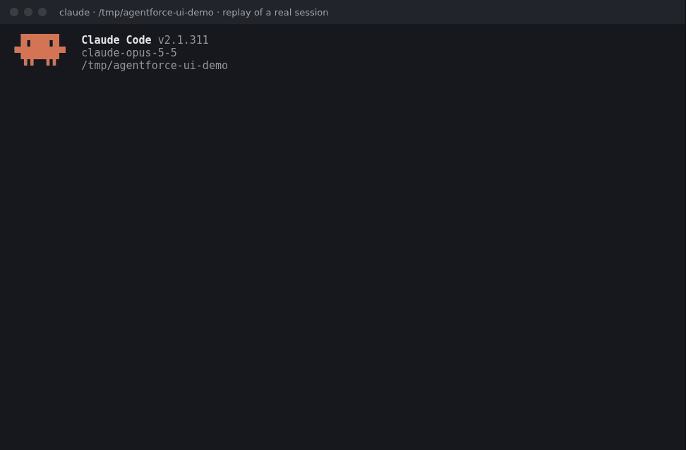
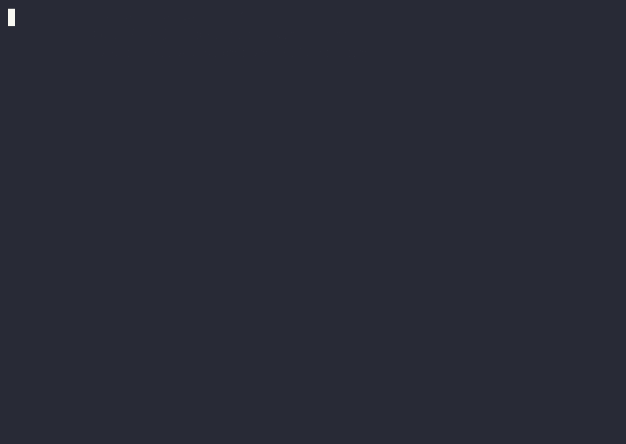
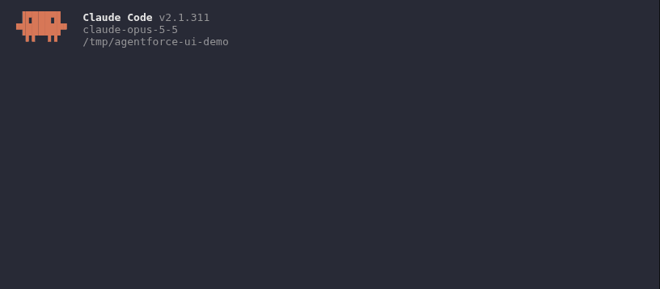

# SFAgent Tools

**Test Agentforce agents from prompt to pixel, with Claude Code and Playwright.**


<table>
<tr>
<td width="50%"><b>Claude Code writes both tests</b><br></td>
<td width="50%"><b>…and finds the layer that broke</b><br></td>
</tr>
</table>

<sub>Real runs in a scratch org (the top GIF at 1.5x). [Full walkthrough video (MP4, 85 s)](demo/prompt-to-pixel.mp4)</sub>

[](LICENSE)
[](https://www.npmjs.com/package/sfagent-tools-mcp-server)
[](https://code.claude.com)
[](https://playwright.dev)
[](https://developers.openai.com/codex)
[](https://developer.salesforce.com/docs/platform/einstein-for-devs/guide/devagent-mcp.html)

---

## Two layers, one scenario

| Layer | What it checks | How |
| --- | --- | --- |
| **What the agent decides** | Routing to the right subagent, actions, the response | Native Agentforce tests (Agentforce Studio or Testing Center), created and run through the MCP tools |
| **What the user sees** | Custom Lightning Type forms and cards in the Agentforce panel | Playwright tests that Claude Code writes and runs with the `agentforce-ui-test` skill |

Native tests run in a channel that reports `__supports_result_display__: false`: they never render the UI. Break the
card your agent shows and the native test still passes. The Playwright test catches it.

## Try it

[`examples/agentforce-ui-demo`](examples/agentforce-ui-demo) has everything: a script that creates a scratch org, an
employee agent whose action shows a form and a result card, a native test and a Playwright test. Then ask Claude Code:

> *"Test what my agent shows users, end to end, and pair it with a native test."*

## What's new in 2.0

- **UI layer:** the `agentforce-ui-test` skill and a Playwright kit (one-time frontdoor login, an Agentforce panel page
  object, config).
- **Native tests, current format:** Agentforce Studio tests (`AiTestingDefinition`) alongside legacy Testing Center
  ones; run states normalized across both; scorer results parsed. `generate_test_spec` writes Agentforce Studio specs
  by default.
- **Conversations:** preview local authoring bundles (simulated actions by default), typed context variables, every
  reply type kept, and a flag when the agent asks for input through a CLT form.
- **Safer:** the CLI is called without a shell; the production guard asks the org and fails closed. The server now has
  its own tests.

---

## Install in 30 seconds

### Claude Code

Inside Claude:

```
/plugin marketplace add lucianostraga/sfagent-tools
/plugin install sfagent-tools@sfagent-tools-marketplace
```

Or from your shell, before launching:

```bash
claude plugin marketplace add lucianostraga/sfagent-tools
claude plugin install sfagent-tools@sfagent-tools-marketplace
```

### OpenAI Codex

One command:

```bash
codex mcp add sfagent-tools -- npx -y sfagent-tools-mcp-server@latest
```

### Agentforce Vibes

Inside Vibes (IDE or VS Code extension), open the **MCP Tools** panel → **Configure MCP Servers** → add to `a4d_mcp_settings.json`:

```json
{
  "mcpServers": {
    "sfagent-tools": {
      "command": "npx",
      "args": ["-y", "sfagent-tools-mcp-server@latest"]
    }
  }
}
```

That's it for any of them. Now in any project, just say:

> *"Test my Agentforce agent"*

And your AI does the rest.

---

## Every tool, in 10 seconds each

Each clip replays a real Claude Code run. Most are from 1.0 (May 2026), against a sandbox and the Agentforce Service
Agent; `send_message` and `generate_test_spec` were recorded again for 2.0, against the example's scratch org.

### Discover what's in your org

| | |
|---|---|
| **list_orgs** — pick which org to test your agent in (production blocked) |  |
| **list_agents** — list Agentforce agents in an org |  |
| **get_agent_metadata** — see subagents (formerly *topics*) + actions |  |
| **load_config** — read your `sfagent-config.yaml` expectations |  |

### Run a live test

| | |
|---|---|
| **start_session** — open a headless conversation |  |
| **send_message** — send a probe, get the agent's reply, and a flag when the agent asks with a form |  |
| **end_session** — close and return the transcript |  |

### Hand off to CI

| | |
|---|---|
| **generate_test_spec** — turn the conversation into a native test spec (Agentforce Studio by default) |  |

### Diagnose with Salesforce's own traces *(sf CLI 2026-05-20+)*

| | |
|---|---|
| **list_traces** — find local trace files |  |
| **read_trace** — drill into actions + routing per turn |  |

Plus `run_batch_test` and `get_test_results`, which run native tests (Agentforce Studio or Testing Center) and read
their scorer results.

---

## How Claude Code uses it

1. **Discover** the org, the agent and its subagents and actions (`list_orgs`, `list_agents`, `get_agent_metadata`).
2. **Explore** with real headless conversations (`start_session`, `send_message`) and read Salesforce's own traces.
3. **Lock in** what it found as native regression tests (`generate_test_spec`, `run_batch_test`, `get_test_results`).
4. **Check the pixels**: for actions that render Custom Lightning Types, write and run Playwright tests against the
   Agentforce panel (`agentforce-ui-test` skill).

Auth reuses your `sf` CLI login, including the UI tests (a fresh `sf org open --url-only` URL per run, never stored).
Production orgs are blocked: the server asks the org and only allows sandboxes, scratch orgs and Developer Edition.

---

## Other MCP clients (coming soon)

The MCP server itself is generic — anything that speaks the Model Context Protocol can call it via:

```bash
npx -y sfagent-tools-mcp-server@latest
```

**Currently officially supported and tested:** Claude Code, OpenAI Codex, Agentforce Vibes.

**Coming soon (packaged + tested):** Cursor, Continue.dev, Cline, Windsurf, Gemini CLI.

For the full Codex plugin experience (skills + marketplace metadata), see [packages/codex-plugin/README.md](packages/codex-plugin/README.md).

---

## Prerequisites

- [Salesforce CLI](https://developer.salesforce.com/tools/sfdxcli) 2.152 or later, on Node.js 22+
- A sandbox, scratch org or Developer Edition org with an active Agentforce agent
- For the UI layer: Playwright 1.6x with its Chromium, and a user with access to the agent in Lightning Experience
- Claude Code (or any MCP client for the headless tools)

---

## Status

- **2.0.0**: the Playwright UI layer, Agentforce Studio tests, safer CLI calls and server tests. Verified
  end to end against a scratch org on November 18, 2026: Claude Code, starting from a project with no tests, wrote a
  Playwright test and a native test for the same scenario and both passed.
- **1.0.0** (May 2026): headless conversations, traces and run-eval specs, in Claude Code and Codex.

---

## Architecture (for the curious)

This is a monorepo. The MCP server is the actual product — both plugin packagings are thin wrappers around it.

```
sfagent-tools/
├── packages/
│   ├── server/                # sfagent-tools-mcp-server (npm)
│   ├── claude-code-plugin/    # Claude Code packaging
│   └── codex-plugin/          # OpenAI Codex packaging
├── demo/                      # demo video and per-tool clips
├── docs/                      # progress logs, architecture decisions
└── discovery-docs/            # research that informed the design
```

One server. One set of tools. Two install paths.

---

## Development

```bash
npm install                                          # install via npm workspaces
npm run build                                        # build the server
claude --plugin-dir packages/claude-code-plugin      # test the Claude plugin locally
```

For local Codex testing, see [packages/codex-plugin/README.md](packages/codex-plugin/README.md).

---

## Contributing

Issues and PRs welcome. The MCP server in [packages/server/](packages/server/) is the single source of truth for tool behavior. Changes to the tool surface ship as a server version bump on npm.

## License

Apache-2.0 — see [LICENSE](LICENSE).
